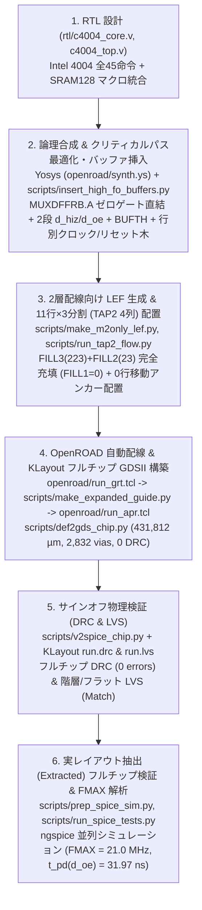

# TR-1um C4004 — Intel 4004 互換 4-bit CPU (OpenSUSI TR-1um 1 µm CMOS)

OpenSUSI **TR-1um PDK**（https://github.com/OpenSUSI/TR-1um — 1 µm シリコンゲート CMOS、2層配線 `M1`/`M2`、電源電圧 `5.0 V`）を用いて設計・レイアウト・実レイアウト抽出後（Post-Layout Extracted）フルチップ検証まで完了した **Intel 4004 完全互換 4-bit マイクロプロセッサ (`C4004` / `tr_1um_jun1okamura`)** です。

> **PDK のセットアップ**: DRC / LVS ルールデッキ（`libs.tech/klayout/tech/`）、SPICE デバイスモデル（`libs.tech/spice/models/`）、およびパッドフレーム GDSII（`libs.tech/klayout/libraries/TR-1um_frame_25x25.gds`）は公式 PDK リポジトリ https://github.com/OpenSUSI/TR-1um を使用します（ローカル実行時は `git clone https://github.com/OpenSUSI/TR-1um.git` で `TR-1um/` に配置、GitHub Actions CI では `info.yaml` の設定により自動チェックアウトされます）。

---

## 1. チップの特徴 (Key Features)

1. **Intel 4004 全45命令互換アーキテクチャ (`c4004_core`)**
   - 1ワード命令・2ワード命令（`FIM`, `SRC`, `FIN`, `JIN`, `JUN`, `JMS`, `BBL`, `JCN`, `ISZ`, `ADD`, `SUB`, `LD`, `XCH`, `INC`, `LDM`, `WRM`, `RDM`, `ADM`, `SBM` 等）および全アキュムレータ命令群（`CLB`, `CLC`, `IAC`, `CMC`, `CMA`, `RAL`, `RAR`, `TCC`, `DAC`, `TCS`, `STC`, `DAA`, `KBP`, `DCL`）を実装。
   - **8フェーズ命令サイクル (`A1`〜`A3`, `M1`〜`M2`, `X1`〜`X3`)**: `sync` パルス出力、4-bit 双方向マルチプレクスバス `D[3:0]`、ROM バンク選択 `cm_rom`、4系統 RAM バンク選択 `cm_ram[3:0]`、外部条件分岐入力 `test` を備えます。
2. **`SRAM128` ハードマクロ統合 & `MUXDFFRB` ゼロゲート直結による高速化 (`FMAX = 21.0 MHz`)**
   - `32 words × 4 bits`（128 bit）6T CMOS SRAM ハードマクロ (`SRAM128`) をコア上部に配置し、**16本の4-bit インデックスレジスタ (`R0`〜`R15`, `A[4]=0`)** と **12-bit プログラムカウンタ＋3段サブルーチンスタック (`4 × 12-bit`, `A[4]=1`)** を単一マクロに集約。
   - 順序回路は **41個 (`MUXDFFRB`×26, `DFFRB`×15)** で構成し、最難関のハーフサイクルパスである `X1` フェーズ `SRAM128` プリリード (`sram_do[3:0] -> reg_buf[3:0]`) を **`MUXDFFRB` の `.A` 入力へ組合せゲート0段で直結** するとともに、`M1` フェーズの双方向バスターンアラウンド (`d_hiz` / `d_oe`) を `phase[2:0]` FF `.QB` からの **2段並列デコード** に刷新。これにより **`t_pd(d_oe) = 31.97 ns`（Trial-10 比 `-13.50 ns` 短縮）**、フルチップ最大動作周波数 **`FMAX = 21.0 MHz`（Trial-10 の `19.0 MHz` 比 `+2.0 MHz` / `+10.5%` 向上、初期9行版 `15.0 MHz` 比 `+40%` 向上）** を達成。
3. **2層配線 (`M1`/`M2`) プロセスに特化した OpenROAD 11行チャネル配線 & 電源メッシュ**
   - **11行チャネル配線方式（11アクティブ行＋行間 `81.0 µm` 水平配線チャネル）**: 標準セル内部で `M1` が高密度に使用される TR-1um ライブラリに対し、標準セルピンへのアクセスを `M2` 経由に限定 (`TR-1um_cells_m2only.lef`) し、行間の15トラック分の空き領域を水平 `M1` 配線チャネルとして活用することで、OpenROAD Detailed Route **DRC 違反 `0` 件**・総配線長 **`431,812 µm`**（Trial-10 比 `-18,831 µm` 短縮）・総信号ビア **`2,832` 個**（Trial-10 比 `-153` 個削減）で全670信号ネットを 100% 自動配線。
   - **`TAP2` 縦4列によるコア3分割＋`M2` 電源ストラップ強化**: 標準セル領域を `TAP2`（基板・ウェルタップ＋`VDD`/`VSS` 縦ストラップ）4列で横方向に **3分割（`108 / 109 / 108` サイト = 1行 `325` サイト、全11行 `3,575` サイト）** し、両端 `TAP2` 列および `SRAM128` 左右両端の `VDD`/`VSS` を `VDDPAD` (`P16`) および4辺の `OSS_FRAME_GIO` `M2` `VSS` リング (`P8`) に直結。
   - **`FILL1` ゼロ・100% アクティブデキャップ (`FILL3`/`FILL2`) 充填**: 論理セル稼働率を `80.00%` (`2,860 / 3,575` サイト) に揃え、残り `715` サイトすべてに MOS 容量内蔵フィラー **`FILL3`（223個）および `FILL2`（23個）の計246個（492 MOSFET）** を充填し、**`FILL1 = 0` 個** を達成。
4. **耐ノイズ入力 (`BUFTH`) と空間分割ファンアウトバッファツリー**
   - 全7外部入力端子 (`clk`, `rst`, `test`, `d_in[3:0]`) の初段にシュミットトリガ入力バッファ `BUFTH` を挿入し、クロック・リセットの行別バッファツリー (`BUF_X2`) と高ファンアウト信号の空間分割により全ネットの最大ファンアウトを `FO <= 10` に厳密制限。

---

## 2. 設計諸表まとめ (Design Specifications & Summary)

### 2.1 物理・回路統計諸表 (`apr/c4004_chip.gds`, `apr/OSS_FRAME.extracted`)

| 項目 | 仕様・数値 | 内訳・備考 |
| :--- | :--- | :--- |
| **テクノロジ / PDK** | OpenSUSI TR-1um CMOS | 1 µm Gate, 2-Metal (`M1`, `M2`), 1-Poly (`GT`), `VDD = 5.0 V` |
| **トップセル名** | `tr_1um_jun1okamura` (`OSS_FRAME` / `c4004_core`) | `src/tr_1um_jun1okamura.gds` / `apr/c4004_chip.gds` |
| **チップ外形寸法 (Die Size)** | **`2500.0 µm × 2500.0 µm`** | 面積 **`6.2500 mm²`**, 16 I/O パッド (`OSS_FRAME_GIO`) |
| **コア外形寸法 (Core Size)** | **`1840.0 µm × 1848.4 µm`** | 面積 **`3.4011 mm²`** (I/O リング内領域 `1860 × 1860 µm`) |
| **ハードマクロ (`SRAM128`)** | **`1166.1 µm × 185.6 µm`** | 面積 **`0.2164 mm²`**, `32 words × 4 bits` 6T SRAM (`1,212` MOSFETs) |
| **標準セル行構成** | **11 Rows × 3 Segments (`TAP2` 4列)** | 行高 `59.4 µm` (11サイト), 行ピッチ `140.4 µm` (行間チャネル `81.0 µm` = 15トラック), 全 `3,575` サイト |
| **総配置セル数 (GDSII)** | **`925` セル** | I/O パッド `16` + コア内 `909` (`618` 論理セル + `1` `SRAM128` + `246` `FILL3/2` + `44` `TAP2`, **`FILL1 = 0`**) |
| **論理セル内訳 (`618` cells)** | FF **`41`個** / 組合せ・バッファ **`577`個** | `MUXDFFRB`: 26, `DFFRB`: 15, `BUFTH`: 7, `BUF_X2`: 43, `NAND2`: 87, `AOI21`: 65, `NOR2`: 63, `OAI21`: 53 他 (`2,860` サイト = `80.00%`) |
| **総素子数 (Extracted Devices)** | **`6,742` 素子** (`7,002` フィンガ) | MOSFET **`6,714`個** (`PMOS`: 3,163, `NMOS`: 3,521, `NMOSE`: 30; フィンガ分割後 `6,974`個) + ESD ダイオード **`28`個** (`DN`) |
| **領域別トランジスタ数** | 標準セル **`4,726`** / SRAM **`1,212`** / デキャップ **`492`** | コア合計: **`6,430` MOSFETs**, I/O パッド: `312` 素子 (`572` フィンガ) |
| **総詳細配線長 / 信号ビア数** | **`431,812 µm`** / **`2,832` Signal Vias** | `METAL1`: `214,820 µm`, `METAL2`: `216,991 µm`, コア信号ネット: `670` 本 (Trial-10 比 `-18,831 µm` / `-153` vias) |
| **サインオフ検証 (DRC / LVS)** | **DRC `0` 件 / LVS 完全一致 (`Match`)** | OpenROAD DRT DRC `0` 件, KLayout フルチップ DRC `0` 件 & 階層(`deep`)/フラット(`flat`) LVS 完全一致 |

### 2.2 実レイアウト抽出ネット (`OSS_FRAME.extracted`) 動作性能・消費電力 (`VDD = 5.0 V`, 負荷 `1.0 pF`)

| 性能指標 | 実測値 (`ngspice` Post-Layout) | 条件・備考 |
| :--- | :--- | :--- |
| **フルチップ最大動作周波数 (`FMAX`)** | **`21.0 MHz`** (`T_clk = 47.62 ns`) | `SRAM128` リード/ライト (`FIM`/`LD`/`ADD`/`RAL`/`WRR`/`JMS`/`BBL`)・双方向 `D[3:0]` 含む全命令完走（オリジナル Intel 4004 `740 kHz` の **28.4倍**、Trial-10 `19.0 MHz` 比 **`+2.0 MHz` 向上**） |
| **パッド出力伝搬遅延 (`P1 clk↑ -> Pad`)** | **`31.97 ns` 〜 `41.11 ns`** (`@ 21.0 MHz`) | `d_oe`: **`31.97 ns`** (Trial-10 比 `-13.50 ns`), `sync`: **`34.90 ns`**, `cm_rom`: **`35.09 ns`**, `D[3:0]`: **`39.10 ns`**, `cm_ram[3:0]`: **`41.11 ns`** |
| **消費電流・消費電力 (`@ 1.0 MHz`)** | **`0.318 mA` / `1.59 mW`** | フルチップ連続命令実行時平均 (`VDD = 5.0 V`) |
| **消費電流・消費電力 (`@ 10.0 MHz`)** | **`2.941 mA` / `14.70 mW`** | フルチップ連続命令実行時平均 (`VDD = 5.0 V`) |
| **消費電流・消費電力 (`@ 19.0 MHz`)** | **`5.529 mA` / `27.64 mW`** | Trial-10 上限周波数での連続命令実行時平均 (`VDD = 5.0 V`) |
| **消費電流・消費電力 (`@ 21.0 MHz`)** | **`6.107 mA` / `30.54 mW`** | `FMAX` (`21.0 MHz`) フルチップ連続命令実行時平均 (`VDD = 5.0 V`) |

### 2.3 パッド配置表 (`OSS_FRAME` 16ピン割り当て)

| パッド番号 | パッド座標・辺 | 信号名 | I/O 種別 | パッドセル | 機能説明 |
| :---: | :---: | :--- | :---: | :--- | :--- |
| **P1** | 北辺 (Top) | `clk` | Input | `OSS_ESD_5V_DIO` | 単相システムクロック入力 (内部初段 `BUFTH` 経由) |
| **P2** | 北辺 (Top) | `sync` | Output | `OSS_ESD_5V_DIO` | 8フェーズ命令サイクル同期パルス出力 (`X3` フェーズで High) |
| **P3 〜 P6** | 西辺 (Left) | `D[3]` 〜 `D[0]` | Bidir | `OSS_ESD_5V_DIO` | 4-bit マルチプレクス アドレス/命令/データ双方向バス (`P3=D[3]..P6=D[0]`) |
| **P7** | 南辺 (Bottom) | `rst` | Input | `OSS_ESD_5V_DIO` | 非同期リセット入力 (High アクティブ、内部 `rst_n` 生成) |
| **P8** | 南辺 (Bottom) | `VSS` | Power | `OSS_ESD_5V_VSS` | グラウンド (`0.0 V`) — 4辺 `M2` `VSS` リングおよびコア `TAP2` に直結 |
| **P9** | 南辺 (Bottom) | `d_oe` | Output | `OSS_ESD_5V_DIO` | データバス出力イネーブルモニタ (`D[3:0]` 出力駆動時 High) |
| **P10** | 南辺 (Bottom) | `test` | Input | `OSS_ESD_5V_DIO` | `JCN` 命令用外部テスト条件入力 (内部初段 `BUFTH` 経由) |
| **P11 〜 P14** | 東辺 (Right) | `cm_ram[0:3]` | Output | `OSS_ESD_5V_DIO` | RAM バンク選択出力 (`DCL` 命令で制御) |
| **P15** | 北辺 (Top) | `cm_rom` | Output | `OSS_ESD_5V_DIO` | ROM バンク選択ストローブ出力 |
| **P16** | 北辺 (Top) | `VDD` | Power | `OSS_ESD_5V_VDD` | 電源 (`5.0 V`) — 左右 `TAP2`・`SRAM128`・全標準セル行に給電 |

---

## 3. 設計フロー (End-to-End Design Flow)

本チップは以下の6段階のオープンソース EDA フロー（Yosys + OpenROAD + KLayout + ngspice）により設計・検証されています。各ステップの Python スクリプトは [`scripts/`](scripts/README.md) に、OpenROAD/合成設定ファイルは [`openroad/`](openroad/README.md) に格納されています。

---

## 4. ディレクトリ構成 (Repository Structure)

| ディレクトリ / ファイル | 内容説明 |
| :--- | :--- |
| [`rtl/`](rtl/) | `c4004_core.v`（CPU コア RTL）、`c4004_top.v`（`OSS_FRAME` パッドラッパ） |
| [`openroad/`](openroad/README.md) | OpenROAD 向け LEF (`TR-1um_tech_clean.lef`, `TR-1um_cells_m2only.lef`, `TR-1um_cells_grt_m1.lef`, `SRAM128_clean.lef`)、Tcl スクリプト (`run_grt.tcl`, `run_apr.tcl`)、Yosys 合成スクリプト (`synth.ys`, `dffe_map.v`)、配線ガイド・DEF（詳細は [`openroad/README.md`](openroad/README.md)） |
| [`scripts/`](scripts/README.md) | 合成後最適化・バッファ挿入、LEF 生成、11行配置・フィラー充填、GDSII 構築、LVS SPICE 生成、`ngspice` フルチップ検証用 Python スクリプト群（詳細は [`scripts/README.md`](scripts/README.md)） |
| [`apr/`](apr/) | 最終レイアウト `c4004_chip.gds` (`OSS_FRAME`)、配線済み DEF `c4004_core_routed.def`、LVS 用 SPICE `c4004_chip.spice`、抽出ネットリスト `OSS_FRAME.extracted`、`ngspice` 検証デッキ＆ログ (`sim_test*.sp`, `sim_test*.log`) |
| [`apr/simulation/`](apr/simulation/VERIFICATION_SUMMARY.md) | 検証・`FMAX`・クリティカルパス解析・統計レポート [`VERIFICATION_SUMMARY.md`](apr/simulation/VERIFICATION_SUMMARY.md)、シミュレーション用ネットリスト |
| [`module/STDCELL/`](module/STDCELL/README.md) | TR-1um 標準セルライブラリ (`TR-1um_STDCELL.gds`, `tr1um_typ_5v0_25c.lib`, `TR-1um_cells.lef`, `simulation/*.spice`) |
| [`module/SRAM128/`](module/SRAM128/) | `32×4-bit` 6T CMOS SRAM ハードマクロ (`SRAM128.gds`, `SRAM128.lef`, `SRAM128.lib`, `SRAM128.spice`) |
| [`reference/`](reference/README.md) | 事前調査・6T SRAM 設計・初期9行版から今回の Trial-10 ベース再設計までの全技術記録（[`reference/09_work_memo.md`](reference/09_work_memo.md)） |
| [`src/`](src/) | OpenSUSI MPW 提出用ディレクトリ (`tr_1um_jun1okamura.gds`, `tr_1um_jun1okamura.cir`) |
| [`info.yaml`](info.yaml) | OpenSUSI MPW CI (Pre-check / DRC / LVS / MDP) 設定ファイル |

---

## 5. 再設計の経緯とアーキテクチャ進化の記録 (Redesign History)

本設計は、初期9行ベースライン実装（`FMAX = 15.0 MHz`）および 10 回のクローンビルド実験（`Clone2Build` Trial-01〜Trial-10）の比較調査に基づき、最速であった **Trial-10 (`FMAX = 19.0 MHz`)** のボトルネックを徹底解剖して再設計したものです（詳細は [`reference/09_work_memo.md` §11](reference/09_work_memo.md) および [`apr/simulation/VERIFICATION_SUMMARY.md`](apr/simulation/VERIFICATION_SUMMARY.md) を参照）。

### 5.1 世代別進化の比較

| 設計世代 | 行数・サイト数 | 論理稼働率 | デキャップ (`FILL3`/`FILL2`) | `FILL1` | 総配線長 (`DRT`) | 信号ビア数 | `t_pd(d_oe)` | フルチップ `FMAX` |
| :--- | :---: | :---: | :---: | :---: | :---: | :---: | :---: | :---: |
| **1. 初期9行ベースライン** | 9行 (`2,925` sites) | `84.8%` | `42` 個 (`29 / 13`) | `3` 個 | `461,210 µm` | `4,162` | `43.96 ns` | `15.0 MHz` |
| **2. Trial-09 (`Clone2Build`)** | 11行 (`3,575` sites) | `79.6%` | `248` 個 (`218 / 30`) | `0` 個 | `430,680 µm` | `2,879` | `43.31 ns` | `18.0 MHz` |
| **3. Trial-10 (`Clone2Build`)** | 11行 (`3,575` sites) | `79.8%` | `248` 個 (`223 / 25`) | `0` 個 | `450,643 µm` | `2,985` | `45.47 ns` | `19.0 MHz` |
| **4. 本再設計 (Final)** | **11行 (`3,575` sites)** | **`80.00%`** | **`246` 個 (`223 / 23`)** | **`0` 個** | **`431,812 µm`** | **`2,832`** | **`31.97 ns`** | **`21.0 MHz`** |

### 5.2 Trial-10 のボトルネック診断と解決策
1. **`X1` フェーズ `SRAM128` プリリードパス (`19.5 MHz` での誤動作 & 配線長 `+19.9 mm` 増加の解消)**:
   - **原因**: Trial-10 では `sram_do[3:0]`（`clk=0` の後半ハーフサイクルで読み出し）が `NAND2 -> NAND3` の2段ゲートを通って `reg_buf[3:0]` (`MUXDFFRB _1143_.._1146_.B`) に入力されていた上、配置スクリプトの目標座標タイポ (`480.0 µm`) により `_1143_.._1146_` が西端に配置され、東側の `u_sram.DO[3:0]` から `1,200 µm` 以上の横断配線と16個の FF の行玉突き移動を引き起こしていた。
   - **解決**: フルサイクル前に確定する選択信号 `rb_sram_sel_n = !(_0283_ & _0307_)` を `MUXDFFRB.S` に入れ、**`sram_do[3:0]` を組合せゲート0段で `MUXDFFRB.A` に直結**。さらに `sram_ce` を2入力 `NOR2` 化して `u_sram.CE` 直下にアンカー配置し、`_1143_.._1146_` を Row 6 東側に配置・行別 FF 割当数を整合させたことで、**全37個の他 FF の行移動をゼロ (`0` row displacement)** に抑え、総配線長を **`-18,831 µm` 短縮 (`431,812 µm`)**、信号ビアを **`-153` 個削減 (`2,832` 個)**。
2. **`M1` フェーズ `d_hiz` / `d_oe` 双方向バスターンアラウンドパス (`20.0 MHz` での誤動作の解消)**:
   - **原因**: Trial-10 では `A3 -> M1` 遷移時の `d_hiz` / `d_oe` 生成が `phase_0 -> u_fobuf -> NOR3 -> OR2 -> NOR4 (直列 PMOS 4段) -> INV_X1` の6段チェーンを経由し、`t_pd(d_oe) = 45.47 ns` を要していた。
   - **解決**: `phase[2:0]` FF の `.QB` 出力から直接生成する **2段並列デコード**（`OAI21 u_n_a123` + `NOR2 u_n_x23_oe` → `AND2_X1 _1071_` [`d_hiz_pre`] / `NAND2 _1072_` [`d_oe_pre`]）に刷新し、それぞれ出力バッファ `u_buf_dhiz`（西辺）・`u_buf_doe`（南辺）に隣接配置 (`FO = 1`)。これにより **`t_pd(d_oe)` を `45.47 ns` → `31.97 ns`（`-13.50 ns` / `-29.7%` 短縮）** し、TR-1um `1.0 pF` パッド負荷における上限周波数 **`FMAX = 21.0 MHz`** を達成。
