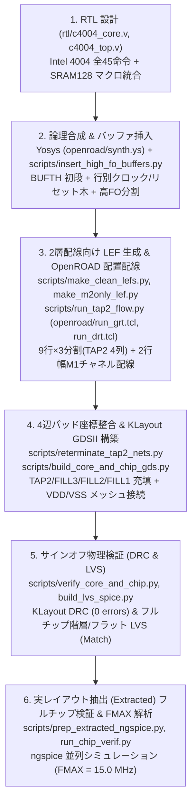

# TR-1um C4004 — Intel 4004 互換 4-bit CPU (OpenSUSI TR-1um 1 µm CMOS)

OpenSUSI **TR-1um PDK**（1 µm シリコンゲート CMOS、2層配線 `M1`/`M2`、電源電圧 `5.0 V`）を用いて設計・レイアウト・実レイアウト抽出後（Post-Layout Extracted）フルチップ検証まで完了した **Intel 4004 完全互換 4-bit マイクロプロセッサ (`C4004`)** です。

---

## 1. チップの特徴 (Key Features)

1. **Intel 4004 全45命令互換アーキテクチャ (`c4004_core`)**
   - 1ワード命令・2ワード命令（`FIM`, `SRC`, `FIN`, `JIN`, `JUN`, `JMS`, `BBL`, `JCN`, `ISZ`, `ADD`, `SUB`, `LD`, `XCH`, `INC`, `LDM`, `WRM`, `RDM`, `ADM`, `SBM` 等）および全アキュムレータ命令群（`CLB`, `CLC`, `IAC`, `CMC`, `CMA`, `RAL`, `RAR`, `TCC`, `DAC`, `TCS`, `STC`, `DAA`, `KBP`, `DCL`）を実装。
   - **8フェーズ命令サイクル (`A1`〜`A3`, `M1`〜`M2`, `X1`〜`X3`)**: `sync` パルス出力、4-bit 双方向マルチプレクスバス `D[3:0]`、ROM バンク選択 `cm_rom`、4系統 RAM バンク選択 `cm_ram[3:0]`、外部条件分岐入力 `test` を備えます。
2. **`SRAM128` ハードマクロ統合による大幅な面積削減**
   - `32 words × 4 bits`（128 bit）6T CMOS SRAM ハードマクロ (`SRAM128`) をコア上部に配置し、**16本の4-bit インデックスレジスタ (`R0`〜`R15`, `A[4]=0`)** と **12-bit プログラムカウンタ＋3段サブルーチンスタック (`4 × 12-bit`, `A[4]=1`)** を単一マクロに集約。
   - 順序回路のフリップフロップ数をわずか **40個 (`DFF_X1`×17, `DFFR_X1`×19, `DFFS_X1`×4)** に抑え、`2.5 mm × 2.5 mm` の `OSS_FRAME`（16パッド）内への収容を実現。
3. **2層配線 (`M1`/`M2`) プロセスに特化した OpenROAD 自動配置配線 & 電源メッシュ**
   - **チャネル配線方式（9アクティブ行＋2行幅 `118.8 µm` 水平配線チャネル）**: 標準セル内部で `M1` が高密度に使用される TR-1um v59_4 ライブラリに対し、標準セルピンへのアクセスを `M2` 経由に限定 (`TR-1um_cells_m2only.lef`) し、行間の2行分（22トラック）の空き領域を水平 `M1` 配線チャネルとして活用することで、セル内 `M1` ショート皆無で全657ネットを 100% 自動配線。
   - **`TAP2` 縦4列によるコア3分割＋`M2` 電源ストラップ強化**: 標準セル領域を `TAP2`（基板・ウェルタップ＋`VDD`/`VSS` 縦ストラップ）4列で横方向に **3分割（`108 / 109 / 108` サイト）** し、両端 `TAP2` 列および `SRAM128` 左右両端の `VDD`/`VSS` を `VDDPAD` (`P16`) および4辺の `OSS_FRAME_GIO` `M2` `VSS` リング (`P8`) に直結。
   - **アクティブ・デカップリングキャパシタ (`FILL3`/`FILL2`) 充填**: 2サイト以上の全空きスペースに MOS 容量内蔵フィラー `FILL3`（29個）および `FILL2`（13個）を配置（1サイト隙間のみ `FILL1`×3個）。
4. **耐ノイズ入力 (`BUFTH`) と空間分割ファンアウトバッファツリー**
   - 全7外部入力端子 (`clk`, `rst`, `test`, `d_in[3:0]`) の初段にシュミットトリガ入力バッファ `BUFTH` を挿入し、クロック・リセットの行別バッファツリー (`BUF_X2`) と高ファンアウト信号の空間2分割により最大ファンアウトを `FO <= 10` に抑制。

---

## 2. 設計諸表まとめ (Design Specifications & Summary)

### 2.1 物理・回路統計諸表 (`apr/c4004_chip.gds`, `apr/OSS_FRAME.extracted`)

| 項目 | 仕様・数値 | 内訳・備考 |
| :--- | :--- | :--- |
| **テクノロジ / PDK** | OpenSUSI TR-1um CMOS | 1 µm Gate, 2-Metal (`M1`, `M2`), 1-Poly (`GT`), `VDD = 5.0 V` |
| **トップセル名** | `OSS_FRAME` (Core: `c4004_core`) | `apr/c4004_chip.gds` / `src/OSS_FRAME.gds` |
| **チップ外形寸法 (Die Size)** | **`2500.0 µm × 2500.0 µm`** | 面積 **`6.2500 mm²`**, 16 I/O パッド (`OSS_FRAME_GIO`) |
| **コア外形寸法 (Core Size)** | **`1840.0 µm × 1848.4 µm`** | 面積 **`3.4011 mm²`** (I/O リング内領域 `1860 × 1860 µm`) |
| **ハードマクロ (`SRAM128`)** | **`1166.1 µm × 185.6 µm`** | 面積 **`0.2164 mm²`**, `32 words × 4 bits` 6T SRAM (`1,212` Tr.) |
| **標準セル行構成** | **9 Rows × 3 Segments (`TAP2` 4列)** | 行高 `59.4 µm` (11サイト), 行間チャネル幅 `118.8 µm` (22トラック) |
| **総配置セル数 (GDSII)** | **`722` セル** | I/O パッド `16` + コア内 `706` (`624` 論理セル + `1` `SRAM128` + `42` `FILL2/3` + `36` `TAP2` + `3` `FILL1`) |
| **論理セル内訳 (`624` cells)** | FF **`40`個** / 組合せ・バッファ **`584`個** | `DFF_X1`: 17, `DFFR_X1`: 19, `DFFS_X1`: 4, `BUFTH`: 7, `BUF_X2`: 92, `BUF_X1`: 68 他 |
| **総素子数 (Extracted Devices)** | **`6,180` 素子** (`6,440` フィンガ) | MOSFET **`6,152`個** (`PMOS`: 2,885, `NMOS`: 3,237, `NMOSE`: 30) + ESD ダイオード **`28`個** (`DN`) |
| **領域別トランジスタ数** | 標準セル **`4,572`** / SRAM **`1,212`** | I/O パッド: `312` 素子 (`572` フィンガ), デキャップ (`FILL2/3`): `84` MOSFET |
| **総ネット数 / 総 `VIA1` 数** | **`2,892` フラットネット** / **`13,884` Vias** | コアトップレベル信号ネット: `657` 本 (電源含め `677` 本), コア配線 Via: `4,162` 個 |
| **サインオフ検証 (DRC / LVS)** | **DRC `0` 件 / LVS 完全一致 (`Match`)** | KLayout DRC & 階層/フラット LVS (`OSS_ESD_5V_DIO`/`VDD`/`VSS` 含むフルチップ) |

### 2.2 実レイアウト抽出ネット (`OSS_FRAME.extracted`) 動作性能・消費電力 (`VDD = 5.0 V`, 負荷 `1.0 pF`)

| 性能指標 | 実測値 (`ngspice` Post-Layout) | 条件・備考 |
| :--- | :--- | :--- |
| **フルチップ最大動作周波数 (`FMAX`)** | **`15.0 MHz`** (`T_clk = 66.7 ns`) | `SRAM128` リード/ライト (`INC`/`SUB`/`LD`/`JMS`/`BBL`)・双方向 `D[3:0]` 含む全命令完走（オリジナル Intel 4004 `740 kHz` の **約20倍**） |
| **コア論理・ALU 最大動作周波数** | **`25.0 MHz`** (`T_clk = 40.0 ns`) | コア内部ステートマシン・フェッチ・ALU 演算 (`LDM`/`IAC`/`RAL`/`STC`/`DAA`/`CMC`) |
| **クロックツリー遅延 (`P1 -> FF CK`)** | **`8.99 ns`** (立上り) / **`6.16 ns`** (立下り) | `P1 (clk)` パッド → `BUFTH` → 行別 `BUF_X2` → `DFF` クロック入力 (`CK`) |
| **パッド出力伝搬遅延 (`P1 clk↑ -> Pad`)** | **`38.87 ns` 〜 `49.19 ns`** | `cm_rom`: `38.87 ns`, `sync`: `38.99 ns`, `D[3:0]`: `42.90 ns`, `d_oe`: `43.96 ns`, `cm_ram[3:0]`: `49.19 ns` |
| **消費電流・消費電力 (`@ 10.0 MHz`)** | **`3.04 mA` / `15.2 mW`** | フルチップ連続命令実行時平均 (`VDD = 5.0 V`) |
| **消費電流・消費電力 (`@ 15.0 MHz`)** | **`4.55 mA` / `22.7 mW`** | `FMAX` (`15.0 MHz`) フルチップ連続命令実行時平均 (`VDD = 5.0 V`) |

### 2.3 パッド配置表 (`OSS_FRAME` 16ピン割り当て)

| パッド番号 | パッド座標・辺 | 信号名 | I/O 種別 | パッドセル | 機能説明 |
| :---: | :---: | :--- | :---: | :--- | :--- |
| **P1** | 北辺 (Top) | `clk` | Input | `OSS_ESD_5V_DIO` | 単相システムクロック入力 (内部初段 `BUFTH` 経由) |
| **P2** | 北辺 (Top) | `sync` | Output | `OSS_ESD_5V_DIO` | 8フェーズ命令サイクル同期パルス出力 (`X3` フェーズで High) |
| **P3 〜 P6** | 西辺 (Left) | `D[0]` 〜 `D[3]` | Bidir | `OSS_ESD_5V_DIO` | 4-bit マルチプレクス アドレス/命令/データ双方向バス |
| **P7** | 南辺 (Bottom) | `rst` | Input | `OSS_ESD_5V_DIO` | 非同期リセット入力 (High アクティブ、内部 `rst_n` 生成) |
| **P8** | 南辺 (Bottom) | `VSS` | Power | `OSS_ESD_5V_VSS` | グラウンド (`0.0 V`) — 4辺 `M2` `VSS` リングおよびコア `TAP2` に直結 |
| **P9** | 南辺 (Bottom) | `d_oe` | Output | `OSS_ESD_5V_DIO` | データバス出力イネーブルモニタ (`D[3:0]` 出力駆動時 High) |
| **P10** | 南辺 (Bottom) | `test` | Input | `OSS_ESD_5V_DIO` | `JCN` 命令用外部テスト条件入力 (内部初段 `BUFTH` 経由) |
| **P11 〜 P14** | 東辺 (Right) | `cm_ram[3:0]` | Output | `OSS_ESD_5V_DIO` | RAM バンク選択出力 (`DCL` 命令で制御) |
| **P15** | 北辺 (Top) | `cm_rom` | Output | `OSS_ESD_5V_DIO` | ROM バンク選択ストローブ出力 |
| **P16** | 北辺 (Top) | `VDD` | Power | `OSS_ESD_5V_VDD` | 電源 (`5.0 V`) — 左右 `TAP2`・`SRAM128`・全標準セル行に給電 |

---

## 3. 設計フロー (End-to-End Design Flow)

本チップは以下の6段階のオープンソース EDA フロー（Yosys + OpenROAD + KLayout + ngspice）により設計・検証されています。各ステップの Python スクリプトは [`scripts/`](file:///Users/okamura/Dropbox/98_LSI_Design/TR-1um_C4004/scripts/README.md) に、OpenROAD/合成設定ファイルは [`openroad/`](file:///Users/okamura/Dropbox/98_LSI_Design/TR-1um_C4004/openroad/README.md) に格納されています。

### Step 1: RTL 設計 (`rtl/c4004_core.v`, `rtl/c4004_top.v`)
- Intel 4004 の全45命令セットと8フェーズ実行エンジンを単相クロック同期回路として記述。
- インデックスレジスタ (`16 × 4-bit`) とプログラムカウンタ/スタック (`4 × 12-bit`) を `SRAM128` (`32 × 4-bit`) に統合し、クロック前半 (`clk = 0`) で `SRAM128` にアクセス、クロック立上りエッジ (`clk↑`) で順序回路を更新するパイプライン構成を採用。

### Step 2: Yosys 論理合成 & 高ファンアウト/シュミットトリガバッファ挿入
- [`openroad/synth.ys`](file:///Users/okamura/Dropbox/98_LSI_Design/TR-1um_C4004/openroad/synth.ys) により TR-1um 標準セルライブラリ (`tr1um_typ_5v0_25c.lib`) と `SRAM128.lib` にマッピング。
- [`scripts/insert_high_fo_buffers.py`](file:///Users/okamura/Dropbox/98_LSI_Design/TR-1um_C4004/scripts/insert_high_fo_buffers.py) により、全7入力ピン初段にシュミットトリガ `BUFTH` を挿入し、配置座標に基づいてクロック (`clk_buf_r*`)・リセット (`rst_n_buf_r*`) を各行ごとにバッファリング、さらにファンアウト8以上の全内部信号に `BUF_X2` を挿入して `openroad/c4004_core_buffered_or.v`（624標準セル＋`SRAM128`）を生成。

### Step 3: OpenROAD フロアプラン・`TAP2` 3分割配置・2層チャネル配線
- [`scripts/make_clean_lefs.py`](file:///Users/okamura/Dropbox/98_LSI_Design/TR-1um_C4004/scripts/make_clean_lefs.py) および [`scripts/make_m2only_lef.py`](file:///Users/okamura/Dropbox/98_LSI_Design/TR-1um_C4004/scripts/make_m2only_lef.py) で、標準セル内部の `M1` 領域 (`y = 1.1..58.3 µm`) を全面 `OBS` とし、ピンアクセスを `METAL2` のみに限定した `openroad/TR-1um_cells_m2only.lef` を生成。
- [`scripts/run_tap2_flow.py`](file:///Users/okamura/Dropbox/98_LSI_Design/TR-1um_C4004/scripts/run_tap2_flow.py)（スタンドアロン実行時は [`openroad/run_grt.tcl`](file:///Users/okamura/Dropbox/98_LSI_Design/TR-1um_C4004/openroad/run_grt.tcl) および [`openroad/run_drt.tcl`](file:///Users/okamura/Dropbox/98_LSI_Design/TR-1um_C4004/openroad/run_drt.tcl)）により、9本のアクティブ標準セル行を4列の `TAP2` (`x = 21.6, 615.6, 1215.0, 1809.0 µm`) で横3セグメントに分割配置し、行間の `118.8 µm` チャネルを用いて Global Route / Detailed Route を完走。

### Step 4: 4辺パッド座標整合 & KLayout フルチップ GDSII 構築
- [`scripts/reterminate_tap2_nets.py`](file:///Users/okamura/Dropbox/98_LSI_Design/TR-1um_C4004/scripts/reterminate_tap2_nets.py) により、全19本のコア境界ピンを `OSS_FRAME_GIO` パッドの引き出し座標に完全一致させ、`apr/c4004_core_4edge_routed.def` を生成。
- [`scripts/build_core_and_chip_gds.py`](file:///Users/okamura/Dropbox/98_LSI_Design/TR-1um_C4004/scripts/build_core_and_chip_gds.py) により、標準セル、`SRAM128`、36個の `TAP2`、デキャップフィラー `FILL3` (29個) / `FILL2` (13個) / `FILL1` (3個)、`M2` 縦電源ストラップ、`SRAM128` 左右電源接続、両端 `VDDPAD` 接続、および `OSS_FRAME_GIO` 4辺 `M2` `VSS` ブリッジを統合し、`apr/c4004_core_routed.gds` およびフルチップ `apr/c4004_chip.gds` (`src/OSS_FRAME.gds`) を出力。

### Step 5: サインオフ DRC / LVS 検証
- [`scripts/build_lvs_spice.py`](file:///Users/okamura/Dropbox/98_LSI_Design/TR-1um_C4004/scripts/build_lvs_spice.py) により、`OSS_ESD_5V_DIO`/`VDD`/`VSS`、`SRAM128`、標準セル、`FILL2`/`FILL3` を含むフルチップ階層 SPICE ネットリスト (`apr/c4004_chip.spice`, `apr/simulation/OSS_FRAME.spice`, `src/OSS_FRAME.cir`) を生成。
- KLayout DRC および LVS により **DRC エラー 0件**、**フルチップ LVS 完全一致** を確認（[`scripts/verify_core_and_chip.py`](file:///Users/okamura/Dropbox/98_LSI_Design/TR-1um_C4004/scripts/verify_core_and_chip.py) でも独立検証可能）。

### Step 6: 実レイアウト抽出ネット (`OSS_FRAME.extracted`) フルチップ `ngspice` 検証 & `FMAX` 解析
- [`scripts/prep_extracted_ngspice.py`](file:///Users/okamura/Dropbox/98_LSI_Design/TR-1um_C4004/scripts/prep_extracted_ngspice.py) で KLayout LVS 抽出ネットリスト (`apr/OSS_FRAME.extracted`) を `ngspice` シミュレーション用 (`apr/simulation/OSS_FRAME_extracted_sim.spice`) に変換。
- [`scripts/run_chip_verif.py`](file:///Users/okamura/Dropbox/98_LSI_Design/TR-1um_C4004/scripts/run_chip_verif.py) で3種類の機能検証テストベンチ（ALU命令群、`SRAM128` レジスタリード/ライト、`JMS`/`BBL` サブルーチンスタック＆`JCN` 分岐）と `10〜40 MHz` の `FMAX` スイープを並列実行し、`apr/simulation/VERIFICATION_SUMMARY.md` に結果を集約。

---

## 4. ディレクトリ構成 (Repository Structure)

| ディレクトリ / ファイル | 内容説明 |
| :--- | :--- |
| [`rtl/`](file:///Users/okamura/Dropbox/98_LSI_Design/TR-1um_C4004/rtl/) | `c4004_core.v`（CPU コア RTL）、`c4004_top.v`（`OSS_FRAME` パッドラッパ） |
| [`openroad/`](file:///Users/okamura/Dropbox/98_LSI_Design/TR-1um_C4004/openroad/README.md) | OpenROAD 向け LEF (`TR-1um_tech_or.lef`, `TR-1um_cells_m2only.lef`, `SRAM128_or.lef` 等)、Tcl スクリプト (`run_grt.tcl`, `run_drt.tcl`, `tap2_exact_pos.tcl`)、Yosys 合成スクリプト (`synth.ys`, `abc.constr`)、配線ガイド・DEF（詳細は [`openroad/README.md`](file:///Users/okamura/Dropbox/98_LSI_Design/TR-1um_C4004/openroad/README.md)） |
| [`scripts/`](file:///Users/okamura/Dropbox/98_LSI_Design/TR-1um_C4004/scripts/README.md) | 合成後バッファ挿入、LEF 生成、OpenROAD 実行、GDSII 構築、LVS SPICE 生成、DRC/LVS 検証、`ngspice` フルチップ検証・統計集計用 Python スクリプト群（詳細は [`scripts/README.md`](file:///Users/okamura/Dropbox/98_LSI_Design/TR-1um_C4004/scripts/README.md)） |
| [`apr/`](file:///Users/okamura/Dropbox/98_LSI_Design/TR-1um_C4004/apr/) | 最終レイアウト `c4004_chip.gds` (`OSS_FRAME`)、コア `c4004_core_routed.gds`、配線済み DEF `c4004_core_4edge_routed.def`、LVS 用 SPICE `c4004_chip.spice`、抽出ネットリスト `OSS_FRAME.extracted` |
| [`apr/simulation/`](file:///Users/okamura/Dropbox/98_LSI_Design/TR-1um_C4004/apr/simulation/VERIFICATION_SUMMARY.md) | `ngspice` フルチップ検証テストベンチ (`tb_chip_*.spice`)、抽出シミュレーションモデル (`OSS_FRAME_extracted_sim.spice`)、検証・`FMAX`・統計レポート [`VERIFICATION_SUMMARY.md`](file:///Users/okamura/Dropbox/98_LSI_Design/TR-1um_C4004/apr/simulation/VERIFICATION_SUMMARY.md) |
| [`module/SRAM128/`](file:///Users/okamura/Dropbox/98_LSI_Design/TR-1um_C4004/module/SRAM128/) | `32×4-bit` 6T CMOS SRAM ハードマクロ (`SRAM128.gds`, `SRAM128.lef`, `SRAM128.lib`, `SRAM128.spice`) |
| [`src/`](file:///Users/okamura/Dropbox/98_LSI_Design/TR-1um_C4004/src/) | OpenSUSI MPW 提出用ディレクトリ (`OSS_FRAME.gds`, `OSS_FRAME.cir`) |
| [`info.yaml`](file:///Users/okamura/Dropbox/98_LSI_Design/TR-1um_C4004/info.yaml) | OpenSUSI MPW CI (Pre-check / DRC / LVS / MDP) 設定ファイル |
