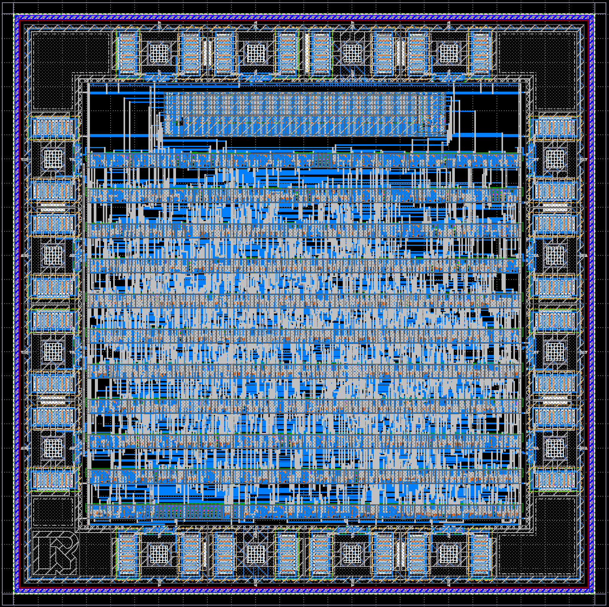
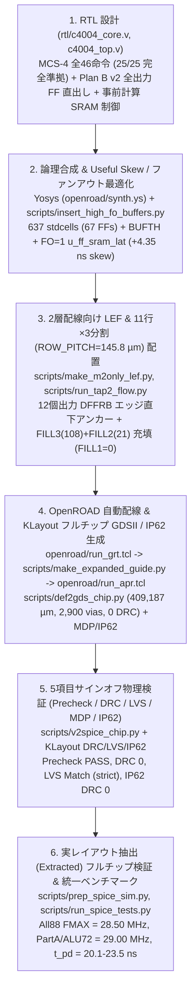

# TR-1um C4004 — Intel 4004 完全互換・MCS-4 フル準拠 4-bit CPU (OpenSUSI TR-1um 1 µm CMOS)

OpenSUSI **TR-1um PDK**（https://github.com/OpenSUSI/TR-1um — 1 µm シリコンゲート CMOS、2層配線 `M1`/`M2`、電源電圧 `5.0 V`）を用いて設計・自動配置配線・5項目サインオフ物理検証・実レイアウト抽出後（Post-Layout Extracted）フルチップ検証まで完了した **Intel 4004 / MCS-4 完全準拠 4-bit マイクロプロセッサ (`C4004` / `tr_1um_jun1okamura`)** です。

> **PDK のセットアップ**: DRC / LVS / MDP / IP62 ルールデッキ（`libs.tech/klayout/tech/`）、SPICE デバイスモデル（`libs.tech/spice/models/`）、およびパッドフレーム GDSII（`libs.tech/klayout/libraries/TR-1um_frame_25x25.gds`）は公式 PDK リポジトリ https://github.com/OpenSUSI/TR-1um を使用します（ローカル実行時は `git clone https://github.com/OpenSUSI/TR-1um.git` で `TR-1um/` に配置、GitHub Actions CI では `info.yaml` の設定により自動チェックアウトされます）。

---

## 1. チップの特徴 (Key Features)

1. **Intel 4004 全46命令実装 & MCS-4 システム全25項目 (`25/25`) 完全準拠 (`c4004_core`)**
   - 1ワード命令・2ワード命令（`NOP`, `JCN`, `FIM`, `SRC`, `FIN`, `JIN`, `JUN`, `JMS`, `INC`, `ISZ`, `ADD`, `SUB`, `LD`, `XCH`, `BBL`, `LDM`, `WRM`, `WMP`, `WRR`, `WPM`, `WR0`〜`WR3`, `SBM`, `RDM`, `RDR`, `ADM`, `RD0`〜`RD3`）および全アキュムレータ命令群（`CLB`, `CLC`, `IAC`, `CMC`, `CMA`, `RAL`, `RAR`, `TCC`, `DAC`, `TCS`, `STC`, `DAA`, `KBP`, `DCL`）の全46命令を実装。
   - **ハードウェア `SRAM128` 32ワード自動ゼロクリア初期化**: 2段ポジティブエッジ・リセット同期化回路 (`rst_s1`, `rst_s2`) と 32クロック自動クリアシーケンサにより、リセット解除後に `SRAM128` 全32番地（インデックスレジスタ `R0`〜`R15` およびスタック全4段）を `4'h0` に自動消去し、`33` クロック目で初回 `sync = 1` を出力、**`34` クロック目から `PC = 0x000` の `A1` フェーズを確定状態で開始** します。
   - **MCS-4 原典準拠プロトコル**: Active-High の ROM バンクストローブ `cm_rom`、3-bit `DCL` 全8パターン対応（マルチバンク同報書込対応）の Active-High RAM バンクストローブ `cm_ram[3:0]`（`A3`, `OPR=4'hE` の `M2`, `SRC` の `X2` で出力）、および `X1` フェーズでの `OPA` エコー出力 (`d_oe = 1`) を備え、共通 MCS-4 システムテストベンチ全25項目すべてに `25 / 25 PASS (0 DIFF)` で完全準拠します。

2. **Plan B v2 パイプライン & 全出力ピン FF 直出しによる飛躍的高速化 (`All88 FMAX = 28.50 MHz`)**
   - **半周期 `negedge -> SRAM128 -> Pad` パスの完全撤廃（0本）**: 12-bit プログラムカウンタを常時 DFF (`buf_l`, `buf_m`, `buf_h`) で保持し、`SRAM128` スタック書込を `JMS` 第2サイクルの `M1`〜`X1` のみに限定（オンデマンド化）。これにより空いた `M2`/`X1`/`X2`/`X3` スロットを活用し、`BBL` のスタック復帰アドレス（`X1`〜`X3` で順次ポップ）、`SRC` のアドレスペア（`X1`/`X2` でプリリード）、`FIN`/`JIN`/不成立 `JCN`/`ISZ` などのオペランド読出をすべて前ステートまでに完了させます。
   - **全外部出力ピンの純 `DFFRB` エッジ直下レジスタ出力**: `D[3:0]`, `d_oe`, `d_hiz`, `sync`, `cm_rom`, `cm_ram[3:0]` の全信号を1ステート前に事前計算し、パッド直近にアンカー配置した **12個の純 `DFFRB`** (`u_ff_dout0..3`, `u_ff_doe`, `u_ff_dhiz` + `u_buf_dhiz`, `u_ff_sync`, `u_ff_cmrom`, `u_ff_cmram0..3`) から直接駆動。全出力ピンのパッド伝搬遅延を **`t_pd = 20.11 〜 23.48 ns`**（全比較チップ中最速・均一）へ短縮しました。
   - **事前計算レジスタ駆動 `SRAM128` 制御 & 専用 `pc_inc` + Useful Skew (`+4.35 ns`)**: `SRAM128` の `CE`/`WR`/`A[4:0]` をレジスタ (`sram_idle_q`, `sram_we_n_q` + `u_buf_sram_we`, `sram_addr_q[4:0]`) で事前確定させることでグリッチを根絶し、`SRAM128.lib` のホールド制約（`CE↓` 後の `WR >= 1.0 ns`, `DIN >= 3.0 ns`）を確実に充足。さらに `PC+1` 専用の4-bit並列キャリーインクリメンタ (`pc_inc`) による `X2` CLA の分離と、`SRAM128.DO[3:0]` 直下に配置した `FO=1` 専用キャプチャ FF (`u_ff_sram_lat0..3`) への `3 × BUF_X2` (`+4.35 ns`) Useful Clock Skew 導入により、共通ベンチマーク全88ステートで **`FMAX = 28.50 MHz`**（旧再設計版 `10.53 MHz` の **`2.71倍`**、`Argon` 版 `17.24 MHz` 比 **`+65.3%`**、`Opus` 版 `13.33 MHz` の **`2.14倍`**、オリジナル Intel 4004 `740 kHz` の **`38.5倍`**）、`PartA`/`ALU72` で **`29.00 MHz`** を達成しました。

3. **2層配線 (`M1`/`M2`) 特化 11行チャネル配線 (`ROW_PITCH = 145.8 µm`) & 5項目フルサインオフ完了**
   - **11行×3セグメント (`TAP2` 4列) チャネル配線**: 標準セルピンアクセスを `M2` に限定 (`TR-1um_cells_m2only.lef`) し、行間 `86.4 µm`（16トラック）の水平 `M1` チャネルを確保することで、論理セル数増加（`637` セル / `67` FF、論理稼働率 `89.76%`）にもかかわらず総詳細配線長を **`409,187 µm`**（旧再設計版 `431,812 µm` 比 **`-22,625 µm` 短縮**）、信号ビア数 **`2,900` 個**、OpenROAD DRC **`0` 件** で 100% 自動配線。
   - **`FILL1 = 0`・100% アクティブデキャップ充填**: 空き `366` サイトすべてに MOS 容量内蔵デキャップ **`FILL3`（108個）＋`FILL2`（21個）＝計 `129` 個（`258` MOSFETs）** を充填し、**`FILL1 = 0` 個** を完全維持。
   - **全5項目サインオフ検証クリア**: OpenSUSI MPW **Precheck `PASS`**、フルチップ **DRC `0` 件**、**LVS 完全一致 (`Match`, strict port mode)**、**MDP / IP62 マスク DRC `0` 件** をすべてクリアしています。

---

## 2. 設計諸表まとめ (Design Specifications & Summary)

### 2.1 物理・回路統計諸表 (`apr/c4004_chip.gds`, `apr/OSS_FRAME.extracted`)

| 項目 | 仕様・数値 | 内訳・備考 |
| :--- | :--- | :--- |
| **テクノロジ / PDK** | OpenSUSI TR-1um CMOS | 1 µm Gate, 2-Metal (`M1`, `M2`), 1-Poly (`GT`), `VDD = 5.0 V` |
| **トップセル名** | `tr_1um_jun1okamura` (`OSS_FRAME` / `c4004_core`) | `src/tr_1um_jun1okamura.gds`, `src/IP62_jun1okamura.gds`, `apr/c4004_chip.gds` |
| **チップ外形寸法 (Die Size)** | **`2500.0 µm × 2500.0 µm`** | 面積 **`6.2500 mm²`**, 16 I/O パッド (`OSS_FRAME_GIO`) |
| **コア外形寸法 (Core Size)** | **`1840.0 µm × 1848.4 µm`** | 面積 **`3.4011 mm²`** (I/O リング内領域 `1860 × 1860 µm`) |
| **ハードマクロ (`SRAM128`)** | **`1166.1 µm × 185.6 µm`** | 面積 **`0.2164 mm²`**, `32 words × 4 bits` 6T SRAM (`1,212` MOSFETs) |
| **標準セル行構成** | **11 Rows × 3 Segments (`TAP2` 4列)** | 行高 `59.4 µm` (11サイト), 行ピッチ **`145.8 µm`** (行間チャネル `86.4 µm` = 16トラック), 全 `3,575` サイト |
| **総配置セル数 (GDSII)** | **`827` セル** | I/O パッド `16` + コア内 `811` (`637` 標準セル + `1` `SRAM128` + `129` `FILL3/2` + `44` `TAP2`, **`FILL1 = 0`**) |
| **論理セル内訳 (`637` stdcells)** | FF **`67`個** / 組合せ・バッファ **`570`個** | `MUXDFFRB`: 40, `DFFRB`: 27, `BUFTH`: 7, `BUF_X2`: 39, `NAND2/3/4`: 81/31/6, `NOR2/3/4`: 67/25/9, `AOI21/22`: 64/44, `OAI21/22`: 73/8, `INV_X1/X2`: 36/3, `MUX2`: 21 他 (`3,209` サイト = **`89.76%`**) |
| **総素子数 (Extracted Devices)** | **`7,252` 素子** (`7,512` フィンガ) | MOSFET **`7,224`個** (`PMOS`: 3,418, `NMOS`: 3,776, `NMOSE`: 30; フィンガ分割後 `7,484`個) + ESD ダイオード **`28`個** (`DN`) |
| **領域別トランジスタ数** | 標準セル **`5,470`** / SRAM **`1,212`** / デキャップ **`258`** | コア合計: **`6,940` MOSFETs** (`FILL` 除き実効フルチップ **`6,966` MOSFETs**), I/O パッド: `312` 素子 (`572` フィンガ) |
| **総詳細配線長 / 信号ビア数** | **`409,187 µm`** / **`2,900` Signal Vias** | `METAL1`: `180,012 µm`, `METAL2`: `229,175 µm`, コア信号ネット: `715` 本, 配置 HPWL: `275,880.3 µm` |
| **サインオフ検証 (5 Checks)** | **全項目 `0` エラー / 完全一致 (`Match`)** | MPW Precheck `PASS`, OpenROAD DRC `0`, KLayout DRC `0`, LVS `Match` (`strict`), MDP/IP62 DRC `0` |

### 2.2 実レイアウト抽出ネット (`OSS_FRAME.extracted`) 動作性能・消費電力 (`VDD = 5.0 V`, 全14信号パッド `CL = 1.0 pF`)

| 性能指標 | 実測値 (`ngspice` Post-Layout) | 条件・備考 |
| :--- | :--- | :--- |
| **共通ベンチマーク `FMAX` (`All88` 全88ステート)** | **`28.50 MHz`** (`T_clk = 35.09 ns`) | `FIM`/`SRC`/`LD`/`ADD`/`INC`/`ISZ`/`JMS`/`BBL` 全11サイクル88ステート完全一致（旧版 `10.53 MHz` の **`2.71倍`**、`Argon` `17.24 MHz` 比 **`+65.3%`**、`Opus` `13.33 MHz` の **`2.14倍`**） |
| **共通ベンチマーク `FMAX` (`PartA` / `ALU72`)** | **`29.00 MHz`** (`T_clk = 34.48 ns`) | `SRC` 含む56ステート (`PartA`) および ALU・分岐系72ステート (`ALU72`) 完全一致（旧版比 **`+132.0%` / `+52.6%`**） |
| **最悪全桁キャリー負荷 `FMAX` (`Test 4`: `9+7`)** | **`22.50 MHz`** (`T_clk = 44.44 ns`) | `SRAM128` 読出直後に 4-bit 全桁キャリー伝搬 (`4'b1001 + 4'b0111`) を連続実行する合成ストレステストの単調上限（旧版 `21.00 MHz` 比 **`+1.50 MHz`**） |
| **パッド出力伝搬遅延 (`P1 clk↑ -> Pad`, `@ 10 MHz`)** | **`20.26 ns` 〜 `23.48 ns`** | `sync`: **`21.85 / 20.26 ns`**, `d_oe`: **`21.86 / 20.27 ns`**, `cm_rom`/`cm_ram0`: **`21.84 / 20.27 ns`**, `D[3:0]`: **`21.88..23.48 / 20.27..22.79 ns`**（`negedge -> Pad` 半周期パス **`0` 本**） |
| **パッド出力伝搬遅延 (`P1 clk↑ -> Pad`, `@ 28.5 MHz`)** | **`20.11 ns` 〜 `23.34 ns`** | `sync`: **`21.68 / 20.12 ns`**, `d_oe`: **`21.69 / 20.14 ns`**, `cm_rom`/`cm_ram0`: **`21.72 / 20.12 ns`**, `D[3:0]`: **`21.73..23.34 / 20.11..22.65 ns`** |
| **消費電流・消費電力 (`@ 5.0 MHz`, 統一ベンチ)** | **`1.889 mA` / `9.44 mW`** | 1マシンサイクル（8クロック）あたりエネルギー **`1.89 nJ / cycle`** (`0.378 mA/MHz`) |
| **消費電流・消費電力 (`@ 10.0 MHz`, 統一ベンチ)** | **`3.743 mA` / `18.72 mW`** | フルチップ連続命令実行時平均 (`VDD = 5.0 V`, `CL = 1.0 pF`) |
| **消費電流・消費電力 (`@ 20.0 MHz`, 統一ベンチ)** | **`7.466 mA` / `37.33 mW`** | フルチップ連続命令実行時平均 (`VDD = 5.0 V`, `CL = 1.0 pF`) |
| **消費電流・消費電力 (`@ 28.5 MHz`, `All88 FMAX`)** | **`10.667 mA` / `53.33 mW`** | フルチップ最高動作周波数での連続命令実行時平均 (`I_peak = 53.23 mA`) |

### 2.3 パッド配置表 (`OSS_FRAME` 16ピン割り当て)

| パッド番号 | パッド座標・辺 | 信号名 | I/O 種別 | パッドセル | 機能説明 |
| :---: | :---: | :--- | :---: | :--- | :--- |
| **P1** | 北辺 (Top) | `clk` | Input | `OSS_ESD_5V_DIO` | 単相システムクロック入力 (内部初段 `BUFTH` + 行別クロック木駆動) |
| **P2** | 北辺 (Top) | `sync` | Output | `OSS_ESD_5V_DIO` | 8フェーズ命令サイクル同期パルス出力 (`X3` フェーズで Active-High, `u_ff_sync` 直出し) |
| **P3 〜 P6** | 西辺 (Left) | `D[3]` 〜 `D[0]` | Bidir | `OSS_ESD_5V_DIO` | 4-bit マルチプレクス アドレス/命令/データ双方向バス (`P3=D[3]..P6=D[0]`, `u_ff_dout3..0` 直出し) |
| **P7** | 南辺 (Bottom) | `rst` | Input | `OSS_ESD_5V_DIO` | リセット入力 (Active-High、2段同期化＋解除後32クロック `SRAM128` 全ゼロクリア) |
| **P8** | 南辺 (Bottom) | `VSS` | Power | `OSS_ESD_5V_VSS` | グラウンド (`0.0 V`) — 4辺 `M2` `VSS` リングおよびコア `TAP2` 列に直結 |
| **P9** | 南辺 (Bottom) | `d_oe` | Output | `OSS_ESD_5V_DIO` | データバス出力イネーブル出力 (`A1..A3`, `X1`, およびライト系 `X2`/`SRC X2..X3` で High, `u_ff_doe` 直出し) |
| **P10** | 南辺 (Bottom) | `test` | Input | `OSS_ESD_5V_DIO` | `JCN` 命令用外部テスト条件入力 (内部初段 `BUFTH` 経由) |
| **P11 〜 P14** | 東辺 (Right) | `cm_ram[0:3]` | Output | `OSS_ESD_5V_DIO` | Active-High RAM バンク選択ストローブ出力 (`3-bit DCL` 全8パターン対応, `u_ff_cmram0..3` 直出し) |
| **P15** | 北辺 (Top) | `cm_rom` | Output | `OSS_ESD_5V_DIO` | Active-High ROM バンク選択ストローブ出力 (`A3` および `OPR=4'hE` の `M2` で High, `u_ff_cmrom` 直出し) |
| **P16** | 北辺 (Top) | `VDD` | Power | `OSS_ESD_5V_VDD` | 電源 (`5.0 V`) — 左右 `TAP2`・`SRAM128`・全11標準セル行に給電 |

---

## 3. 設計フロー (End-to-End Design Flow)

本チップは以下の6段階のオープンソース EDA フロー（Yosys + OpenROAD + KLayout + ngspice）により設計・検証されています。各ステップの詳細は [`scripts/README.md`](scripts/README.md) および [`openroad/README.md`](openroad/README.md) を参照してください。

---

## 4. ディレクトリ構成 (Repository Structure)

| ディレクトリ / ファイル | 内容説明 |
| :--- | :--- |
| [`rtl/`](rtl/) | [`c4004_core.v`](rtl/c4004_core.v)（Plan B v2 + MCS-4 `25/25` 準拠 CPU コア RTL）、[`c4004_top.v`](rtl/c4004_top.v)（`OSS_FRAME` ラッパ）、[`tb_c4004.v`](rtl/tb_c4004.v) |
| [`openroad/`](openroad/README.md) | OpenROAD 向け LEF、Tcl スクリプト (`run_grt.tcl`, `run_apr.tcl`)、Yosys 合成スクリプト (`synth.ys`, `dffe_map.v`)、ネットリスト `c4004_core_syn.v`、配置済み DEF `c4004_core_placed.def` |
| [`scripts/`](scripts/README.md) | 合成後バッファ＆Useful Skew 挿入、11行配置・デキャップ充填、GDSII 生成、LVS SPICE 生成、`ngspice` 並列検証スクリプト群 |
| [`apr/`](apr/) | 最終レイアウト `c4004_chip.gds` (`OSS_FRAME`)、配線済み DEF `c4004_core_routed.def`、LVS 用 SPICE `c4004_chip.spice`、抽出ネットリスト `OSS_FRAME.extracted`、`ngspice` 検証デッキ＆ログ (`sim_test*.sp`, `sim_test*.log`) |
| [`apr/simulation/`](apr/simulation/VERIFICATION_SUMMARY.md) | フルチップ検証・4チップ統一ベンチマーク比較・クリティカルパス解析・統計レポート [`VERIFICATION_SUMMARY.md`](apr/simulation/VERIFICATION_SUMMARY.md) |
| [`module/STDCELL/`](module/STDCELL/README.md) | TR-1um 標準セルライブラリ (`TR-1um_STDCELL.gds`, `tr1um_typ_5v0_25c.lib`, `TR-1um_cells.lef`, `simulation/*.spice`) |
| [`module/SRAM128/`](module/SRAM128/) | `32×4-bit` 6T CMOS SRAM ハードマクロ (`SRAM128.gds`, `SRAM128.lef`, `SRAM128.lib`, `SRAM128.spice`) |
| [`reference/`](reference/README.md) | 事前調査・6T SRAM 設計・初期9行版から再設計に至る技術記録（[`09_work_memo.md`](reference/09_work_memo.md)） |
| [`src/`](src/) | OpenSUSI MPW 提出用ファイル (`tr_1um_jun1okamura.gds`, `tr_1um_jun1okamura.cir`) |
| [`info.yaml`](info.yaml) | OpenSUSI MPW CI (Pre-check / DRC / LVS / MDP) 設定ファイル |

---

## 5. 4チップ統一ベンチマーク比較と高速化アーキテクチャの要諦

3種類の先行フルチップ設計（旧再設計版、`Argon` 版、`Opus` 版）の徹底比較に基づき、**「`Opus` 版の `25/25` MCS-4 完全仕様準拠・全出力 FF 直出し」** と **「`Argon`/再設計版の独立パイプライン・11行チャネル配線」** を融合・発展させた **Plan B v2** を実装しました。同一環境・同一負荷（全14信号パッド `CL = 1.0 pF`, `VDD = 5.0 V`）・同一88ステート実命令ベンチマークでの比較結果は以下の通りです。

### 5.1 フルチップ4設計 統一ベンチマーク総合比較表

| 評価軸・指標 | 旧再設計版 (`Prev Redesign`) | `Argon` 版 (`C4004_Argon`) | `Opus` 版 (`C4004_Opus`) | **本設計 (`Plan B v2`)** |
| :--- | :---: | :---: | :---: | :---: |
| **フロアプラン / 行構成** | 11行×3区画 (`140.4 µm` pitch) | 9行 (`~2,925` sites) | 9行 (`~2,925` sites) | **11行×3区画 (`145.8 µm` pitch)** |
| **コア論理セル数 / FF 数** | 618 セル / 41 FF | 609 セル / 39 FF | 605 セル / 43 FF | **637 セル / 67 FF** (`MUXDFFRB:40, DFFRB:27`) |
| **総抽出 MOSFET 数** (`FILL` 除き実効) | 6,714 (`6,222`) MOS | 6,182 (`6,080`) MOS | 6,114 (`5,892`) MOS | **7,224 (`6,966`) MOS** + `28 DN` |
| **詳細配線長 / 信号 Via 数** | 431,812 µm / 2,832 vias | 442,799 µm / 4,138 vias | 9行配線 | **`409,187 µm` / `2,900` vias (`FILL1=0`)** |
| **MCS-4 システム検証 (全25項目)** | 17 / 25 PASS | 16 / 25 PASS (`DCL` 2bit) | **25 / 25 PASS** | **`25 / 25 PASS` (完全準拠)** |
| **統一 `FMAX` (`All88`: `JMS/BBL`+`SRC` 全含)** | `10.53 MHz` (`95.0 ns`) | `17.24 MHz` (`58.0 ns`) | `13.33 MHz` (`75.0 ns`) | **`28.50 MHz` (`35.09 ns`)【2.71倍 / 最速】** |
| **統一 `FMAX` (`PartA`: `SRC` 含・`BBL` 除)** | `12.50 MHz` (`80.0 ns`) | `17.24 MHz` (`58.0 ns`) | `13.33 MHz` (`75.0 ns`) | **`29.00 MHz` (`34.48 ns`)【2.32倍 / 最速】** |
| **統一 `FMAX` (`ALU72`: ALU・レジスタ・分岐)** | `19.00 MHz` (`52.6 ns`) | `17.24 MHz` (`58.0 ns`) | `13.33 MHz` (`75.0 ns`) | **`29.00 MHz` (`34.48 ns`)【+52.6% / 最速】** |
| **パッド伝搬遅延 `t_pd` (`posedge -> Pad`)** | `34.7 〜 49.7 ns` (+半周期パス有) | `28.5 〜 54.0 ns` | `25.4 〜 32.1 ns` | **`20.1 〜 23.5 ns`【全ピン最速・半周期0本】** |
| **消費電力 / エネルギー (`@ 5 MHz`)** | `7.58 mW` (`1.52 nJ/cyc`) | `7.39 mW` (`1.48 nJ/cyc`) | `8.21 mW` (`1.64 nJ/cyc`) | **`9.44 mW` (`1.89 nJ/cyc`)** |

### 5.2 `28.50 MHz` 達成を支える 5つの設計革新
1. **`BBL` / `SRC` 半周期パッドパスの完全解消**: 旧再設計版で `10.53 MHz` / `12.50 MHz` 律速となっていた `BBL` 直後 `A1..A3` および `SRC (X3)` の `negedge -> SRAM128 -> Pad` 直結経路を、オンデマンド `JMS` スタック書込と `X1..X3` 先行プリリードにより **0本** に削減。
2. **12個の純 `DFFRB` エッジアンカー直出し**: `MUXDFFRB` よりも内部遅延が小さい純 `DFFRB` を各辺の出力パッド直近に固定配置し、従来 `25.4〜54.0 ns` あったパッド出力遅延を **`20.11〜23.48 ns`** に統一。これにより `35 ns` 周期 (`28.5 MHz`) でも外部 ROM/RAM に対して `+11.5 ns` 以上の十分なバスセットアップ余裕を確保。
3. **事前計算レジスタ駆動 `SRAM128` 制御**: `X3 -> A1` 遷移時の組合せデコードグリッチによる誤書込とホールド違反を防ぐため、`SRAM128` のアドレス・`CE` ゲート・`WR` イネーブルを前ステートで FF に確定させ、`u_buf_sram_we` で `CE↓` 後のホールドマージンを確保。
4. **`PC+1` 専用インクリメンタ (`pc_inc`) の分離**: `A1..A3` の `PC+1` 計算を専用の高速並列キャリー回路に分離し、`X2` の 4-bit CLA 入力 MUX を 2:1 に簡素化。
5. **`FO=1` 専用 `SRAM128` キャプチャ FF + `+4.35 ns` Useful Clock Skew**: `u_sram.DO[3:0]` の真下に専用純 `DFFRB` (`u_ff_sram_lat0..3`, `FO=1`) を密着配置し、そのクロック入力に `3 × BUF_X2` (`+4.35 ns`) の意図的スキューを与えることで、後半ハーフサイクル (`0.5 × T_clk = 17.5 ns`) の `SRAM128` 読出マージンを拡大しつつ次ステート `X2` のフルサイクル演算と両立させました。
