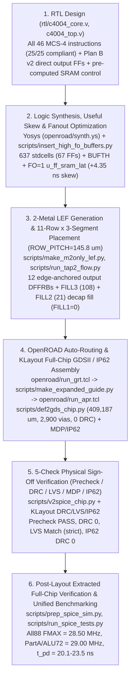

# TR-1um C4004 — Full Intel 4004 Compatible & MCS-4 Compliant 4-bit CPU (OpenSUSI TR-1um 1 µm CMOS)

**`C4004` (`tr_1um_jun1okamura`)** is a **fully Intel 4004 compatible and 100% MCS-4 compliant 4-bit microprocessor** designed, automatically placed and routed, verified through all 5 physical sign-off checks, and validated at the post-layout extracted full-chip transistor level using the OpenSUSI **TR-1um PDK** (https://github.com/OpenSUSI/TR-1um — 1 µm silicon-gate CMOS, 2-layer metal `M1`/`M2`, `5.0 V` supply).

> **PDK Setup**: The DRC / LVS / MDP / IP62 rule decks (`libs.tech/klayout/tech/`), SPICE device models (`libs.tech/spice/models/`), and pad-frame GDSII (`libs.tech/klayout/libraries/TR-1um_frame_25x25.gds`) are provided by the official PDK repository https://github.com/OpenSUSI/TR-1um (clone locally into `TR-1um/` via `git clone https://github.com/OpenSUSI/TR-1um.git`; in GitHub Actions CI, it is checked out automatically as configured in `info.yaml`).

---

## 1. Key Features

1. **Full 46-Instruction Intel 4004 Implementation & 100% (`25/25`) MCS-4 System Compliance (`c4004_core`)**
   - Implements all 46 instructions: 1-word and 2-word instructions (`NOP`, `JCN`, `FIM`, `SRC`, `FIN`, `JIN`, `JUN`, `JMS`, `INC`, `ISZ`, `ADD`, `SUB`, `LD`, `XCH`, `BBL`, `LDM`, `WRM`, `WMP`, `WRR`, `WPM`, `WR0`–`WR3`, `SBM`, `RDM`, `RDR`, `ADM`, `RD0`–`RD3`) and the full accumulator instruction group (`CLB`, `CLC`, `IAC`, `CMC`, `CMA`, `RAL`, `RAR`, `TCC`, `DAC`, `TCS`, `STC`, `DAA`, `KBP`, `DCL`).
   - **Hardware `SRAM128` 32-Word Auto-Zero Initialization**: A 2-stage positive-edge reset synchronizer (`rst_s1`, `rst_s2`) and a 32-clock auto-clear sequencer automatically initialize all 32 words of `SRAM128` (index registers `R0`–`R15` and all 4 stack levels) to `4'h0` upon reset release, assert the initial `sync = 1` pulse on clock `33`, and **deterministically enter phase `A1` at `PC = 0x000` on clock `34`**.
   - **Original MCS-4 Compliant Bus Protocol**: Features an Active-High ROM bank strobe `cm_rom`, Active-High RAM bank strobes `cm_ram[3:0]` supporting all 8 patterns of 3-bit `DCL` (including multi-bank broadcast writes, asserted during `A3`, `M2` when `OPR=4'hE`, and `X2` of `SRC`), and `OPA` echo output (`d_oe = 1`) during phase `X1`, achieving `25 / 25 PASS (0 DIFF)` across the unified 25-item MCS-4 system compliance testbench.

2. **Plan B v2 Pipeline & Direct Registered Output Pads (`All88 FMAX = 28.50 MHz`)**
   - **Complete Elimination of Half-Cycle `negedge -> SRAM128 -> Pad` Paths (`0` paths)**: The 12-bit program counter is continuously held in DFFs (`buf_l`, `buf_m`, `buf_h`), restricting `SRAM128` stack writes strictly to on-demand `JMS` execution (`M1`–`X1` of cycle 2). The freed `M2`/`X1`/`X2`/`X3` SRAM slots are used to pre-read `BBL` return addresses (popped sequentially across `X1`–`X3`), `SRC` register-pair addresses (pre-read in `X1`/`X2`), and operands for `FIN`, `JIN`, not-taken `JCN`, and `ISZ` prior to their output states.
   - **Direct Edge-Anchored Pure `DFFRB` Registered Outputs on All External Pins**: Every external output signal (`D[3:0]`, `d_oe`, `d_hiz`, `sync`, `cm_rom`, `cm_ram[3:0]`) is pre-computed one state ahead and driven directly from **12 pure `DFFRB` flip-flops** (`u_ff_dout0..3`, `u_ff_doe`, `u_ff_dhiz` + `u_buf_dhiz`, `u_ff_sync`, `u_ff_cmrom`, `u_ff_cmram0..3`) anchored immediately adjacent to their respective I/O pads, tightening pad propagation delay across all output pins to a fast, uniform **`t_pd = 20.11 – 23.48 ns`**.
   - **Pre-Computed Registered `SRAM128` Control, Dedicated `pc_inc`, and Useful Skew (`+4.35 ns`)**: Registering `SRAM128` `CE`/`WR`/`A[4:0]` ahead of time (`sram_idle_q`, `sram_we_n_q` + `u_buf_sram_we`, `sram_addr_q[4:0]`) eliminates combinational decode glitches and guarantees `SRAM128.lib` hold constraints (`WR >= 1.0 ns`, `DIN >= 3.0 ns` after `CE↓`). Combined with a dedicated 4-bit parallel-carry `PC+1` incrementer (`pc_inc`) decoupled from the `X2` CLA and a `3 × BUF_X2` (`+4.35 ns`) useful clock skew feeding dedicated `FO=1` capture FFs (`u_ff_sram_lat0..3`) placed directly beneath `SRAM128.DO[3:0]`, the chip achieves **`FMAX = 28.50 MHz`** across all 88 unified benchmark states (**`2.71×`** the previous redesign at `10.53 MHz`, **`+65.3%`** over `Argon` at `17.24 MHz`, **`2.14×`** `Opus` at `13.33 MHz`, and **`38.5×`** the original `740 kHz` Intel 4004) and **`29.00 MHz`** on `PartA` / `ALU72`.

3. **2-Metal (`M1`/`M2`) Optimized 11-Row Channel Routing (`ROW_PITCH = 145.8 µm`) & Full 5-Check Sign-Off**
   - **11 Rows × 3 Segments (`TAP2` 4 Columns) Channel Routing**: Restricting standard-cell pin access to `M2` (`TR-1um_cells_m2only.lef`) and allocating `86.4 µm` (16-track) inter-row horizontal `M1` routing channels enables 100% automatic routing with **`409,187 µm`** total detailed wirelength (**`-22,625 µm` shorter** than the previous redesign's `431,812 µm` despite increasing logic cell count to `637` cells / `67` FFs at `89.76%` logic site utilization), **`2,900` signal vias**, and **`0` OpenROAD DRC violations**.
   - **`FILL1 = 0` & 100% Active Decap Fill**: All `366` spare standard-cell sites are populated exclusively with active MOS decoupling capacitors (**`FILL3`: 108 + `FILL2`: 21 = `129` cells / `258` MOSFETs**), strictly maintaining **`FILL1 = 0`**.
   - **All 5 Physical Sign-Off Checks Cleared**: Passes OpenSUSI MPW **Precheck (`PASS`)**, full-chip **KLayout DRC (`0` violations)**, **LVS (`Match` in strict port mode)**, and **MDP / IP62 mask DRC (`0` violations)**.

---

## 2. Design Specifications & Summary

### 2.1 Physical & Circuit Statistics (`apr/c4004_chip.gds`, `apr/OSS_FRAME.extracted`)

| Item | Specification / Value | Breakdown & Notes |
| :--- | :--- | :--- |
| **Technology / PDK** | OpenSUSI TR-1um CMOS | 1 µm Gate, 2-Metal (`M1`, `M2`), 1-Poly (`GT`), `VDD = 5.0 V` |
| **Top Cell Name** | `tr_1um_jun1okamura` (`OSS_FRAME` / `c4004_core`) | `src/tr_1um_jun1okamura.gds`, `src/IP62_jun1okamura.gds`, `apr/c4004_chip.gds` |
| **Die Size** | **`2500.0 µm × 2500.0 µm`** | Area **`6.2500 mm²`**, 16 I/O pads (`OSS_FRAME_GIO`) |
| **Core Size** | **`1840.0 µm × 1848.4 µm`** | Area **`3.4011 mm²`** (`1860 × 1860 µm` inner I/O ring opening) |
| **Hard Macro (`SRAM128`)** | **`1166.1 µm × 185.6 µm`** | Area **`0.2164 mm²`**, `32 words × 4 bits` 6T SRAM (`1,212` MOSFETs) |
| **Standard-Cell Row Structure** | **11 Rows × 3 Segments (`TAP2` 4 columns)** | Row height `59.4 µm` (11 sites), row pitch **`145.8 µm`** (`86.4 µm` = 16-track inter-row channel), `3,575` total sites |
| **Total Placed Cells (GDSII)** | **`827` cells** | `16` I/O pads + `811` core cells (`637` stdcells + `1` `SRAM128` + `129` `FILL3/2` + `44` `TAP2`, **`FILL1 = 0`**) |
| **Logic Cell Breakdown (`637` stdcells)** | **`67` FFs** / **`570` comb. & buffers** | `MUXDFFRB`: 40, `DFFRB`: 27, `BUFTH`: 7, `BUF_X2`: 39, `NAND2/3/4`: 81/31/6, `NOR2/3/4`: 67/25/9, `AOI21/22`: 64/44, `OAI21/22`: 73/8, `INV_X1/X2`: 36/3, `MUX2`: 21, etc. (`3,209` sites = **`89.76%`**) |
| **Total Extracted Devices** | **`7,252` devices** (`7,512` fingers) | **`7,224` MOSFETs** (`PMOS`: 3,418, `NMOS`: 3,776, `NMOSE`: 30; `7,484` after finger splitting) + **`28` ESD diodes** (`DN`) |
| **Transistor Count by Region** | Stdcells **`5,470`** / SRAM **`1,212`** / Decap **`258`** | Core total: **`6,940` MOSFETs** (effective active full-chip excl. `FILL`: **`6,966` MOSFETs**), I/O pads: `312` devices (`572` fingers) |
| **Routed Wirelength / Signal Vias** | **`409,187 µm`** / **`2,900` Signal Vias** | `METAL1`: `180,012 µm`, `METAL2`: `229,175 µm`, `715` core signal nets, placement HPWL: `275,880.3 µm` |
| **Sign-Off Verification (5 Checks)** | **All `0` Errors / Exact `Match`** | MPW Precheck `PASS`, OpenROAD DRC `0`, KLayout DRC `0`, LVS `Match` (`strict`), MDP/IP62 DRC `0` |

### 2.2 Post-Layout Extracted (`OSS_FRAME.extracted`) Performance & Power (`VDD = 5.0 V`, `CL = 1.0 pF` on All 14 Signal Pads)

| Metric | Measured (`ngspice` Post-Layout) | Conditions & Notes |
| :--- | :--- | :--- |
| **Unified Benchmark `FMAX` (`All88`, all 88 states)** | **`28.50 MHz`** (`T_clk = 35.09 ns`) | Exact match across all 11 machine cycles / 88 states (`FIM`/`SRC`/`LD`/`ADD`/`INC`/`ISZ`/`JMS`/`BBL`) — **`2.71×`** prev. `10.53 MHz`, **`+65.3%`** vs. `Argon` `17.24 MHz`, **`2.14×`** `Opus` `13.33 MHz` |
| **Unified Benchmark `FMAX` (`PartA` / `ALU72`)** | **`29.00 MHz`** (`T_clk = 34.48 ns`) | Exact match across 56 states incl. `SRC` (`PartA`) and 72 ALU/branch states (`ALU72`) (**`+132.0%` / `+52.6%`** vs. prev.) |
| **Worst-Case Full-Carry Stress `FMAX` (`Test 4`: `9+7`)** | **`22.50 MHz`** (`T_clk = 44.44 ns`) | Monotonic upper limit of synthetic back-to-back `SRAM128` read into 4-bit full ripple/CLA carry (`4'b1001 + 4'b0111`) (**`+1.50 MHz`** over prev. `21.00 MHz`) |
| **Pad Output Delay (`P1 clk↑ -> Pad`, `@ 10 MHz`)** | **`20.26 ns` – `23.48 ns`** | `sync`: **`21.85 / 20.26 ns`**, `d_oe`: **`21.86 / 20.27 ns`**, `cm_rom`/`cm_ram0`: **`21.84 / 20.27 ns`**, `D[3:0]`: **`21.88..23.48 / 20.27..22.79 ns`** (**`0`** `negedge -> Pad` half-cycle paths) |
| **Pad Output Delay (`P1 clk↑ -> Pad`, `@ 28.5 MHz`)** | **`20.11 ns` – `23.34 ns`** | `sync`: **`21.68 / 20.12 ns`**, `d_oe`: **`21.69 / 20.14 ns`**, `cm_rom`/`cm_ram0`: **`21.72 / 20.12 ns`**, `D[3:0]`: **`21.73..23.34 / 20.11..22.65 ns`** |
| **Supply Current & Power (`@ 5.0 MHz`, Unified Bench)** | **`1.889 mA` / `9.44 mW`** | Energy per 8-clock machine cycle: **`1.89 nJ / cycle`** (`0.378 mA/MHz`) |
| **Supply Current & Power (`@ 10.0 MHz`, Unified Bench)** | **`3.743 mA` / `18.72 mW`** | Continuous full-chip instruction execution average (`VDD = 5.0 V`, `CL = 1.0 pF`) |
| **Supply Current & Power (`@ 20.0 MHz`, Unified Bench)** | **`7.466 mA` / `37.33 mW`** | Continuous full-chip instruction execution average (`VDD = 5.0 V`, `CL = 1.0 pF`) |
| **Supply Current & Power (`@ 28.5 MHz`, `All88 FMAX`)** | **`10.667 mA` / `53.33 mW`** | Continuous full-chip instruction execution average at `All88 FMAX` (`I_peak = 53.23 mA`) |

### 2.3 Pad Assignment (`OSS_FRAME` 16-Pin Pinout)

| Pad # | Edge | Signal | Type | Pad Cell | Functional Description |
| :---: | :---: | :--- | :---: | :--- | :--- |
| **P1** | North (Top) | `clk` | Input | `OSS_ESD_5V_DIO` | Single-phase system clock input (drives internal first-stage `BUFTH` + per-row clock tree) |
| **P2** | North (Top) | `sync` | Output | `OSS_ESD_5V_DIO` | 8-phase instruction cycle sync pulse output (Active-High in phase `X3`, direct from `u_ff_sync`) |
| **P3 – P6** | West (Left) | `D[3]` – `D[0]` | Bidir | `OSS_ESD_5V_DIO` | 4-bit multiplexed address/instruction/data bidirectional bus (`P3=D[3]..P6=D[0]`, direct from `u_ff_dout3..0`) |
| **P7** | South (Bottom) | `rst` | Input | `OSS_ESD_5V_DIO` | Reset input (Active-High; 2-stage synchronized + 32-clock `SRAM128` auto-zero clear after release) |
| **P8** | South (Bottom) | `VSS` | Power | `OSS_ESD_5V_VSS` | Ground (`0.0 V`) — strapped directly to the 4-edge `M2` `VSS` ring and core `TAP2` columns |
| **P9** | South (Bottom) | `d_oe` | Output | `OSS_ESD_5V_DIO` | Data bus output enable (`High` during `A1..A3`, `X1`, write `X2`, and `SRC` `X2..X3`; direct from `u_ff_doe`) |
| **P10** | South (Bottom) | `test` | Input | `OSS_ESD_5V_DIO` | External test condition input for `JCN` instruction (via internal first-stage `BUFTH`) |
| **P11 – P14** | East (Right) | `cm_ram[0:3]` | Output | `OSS_ESD_5V_DIO` | Active-High RAM bank select strobe outputs (supports all 8 `3-bit DCL` patterns, direct from `u_ff_cmram0..3`) |
| **P15** | North (Top) | `cm_rom` | Output | `OSS_ESD_5V_DIO` | Active-High ROM bank select strobe output (`High` in `A3` and `M2` when `OPR=4'hE`, direct from `u_ff_cmrom`) |
| **P16** | North (Top) | `VDD` | Power | `OSS_ESD_5V_VDD` | Power supply (`5.0 V`) — feeds left/right `TAP2` rails, `SRAM128`, and all 11 standard-cell rows |

---

## 3. End-to-End Design Flow

This chip is designed and verified through the following 6-stage open-source EDA flow (**Yosys + OpenROAD + KLayout + ngspice**). Refer to [`scripts/README.md`](scripts/README.md) and [`openroad/README.md`](openroad/README.md) for detailed instructions on each stage.

---

## 4. Repository Structure

| Directory / File | Description |
| :--- | :--- |
| [`rtl/`](rtl/) | [`c4004_core.v`](rtl/c4004_core.v) (Plan B v2 + MCS-4 `25/25` compliant CPU core RTL), [`c4004_top.v`](rtl/c4004_top.v) (`OSS_FRAME` wrapper), [`tb_c4004.v`](rtl/tb_c4004.v) |
| [`openroad/`](openroad/README.md) | Clean/M2-only LEFs for OpenROAD, Tcl scripts (`run_grt.tcl`, `run_apr.tcl`), Yosys synthesis scripts (`synth.ys`, `dffe_map.v`), post-opt netlist `c4004_core_syn.v`, placed DEF `c4004_core_placed.def` |
| [`scripts/`](scripts/README.md) | Post-synthesis buffer & useful-skew insertion, 11-row placement & decap fill, GDSII assembly, LVS SPICE generation, and parallel `ngspice` verification scripts |
| [`apr/`](apr/) | Final full-chip layout `c4004_chip.gds` (`OSS_FRAME`), routed DEF `c4004_core_routed.def`, LVS schematic netlist `c4004_chip.spice`, extracted netlist `OSS_FRAME.extracted`, `ngspice` decks & logs (`sim_test*.sp`, `sim_test*.log`) |
| [`apr/simulation/`](apr/simulation/VERIFICATION_SUMMARY.md) | Full-chip post-layout verification, 4-chip unified benchmark comparison, critical-path analysis, and statistics report [`VERIFICATION_SUMMARY.md`](apr/simulation/VERIFICATION_SUMMARY.md) |
| [`module/STDCELL/`](module/STDCELL/README.md) | TR-1um standard-cell library (`TR-1um_STDCELL.gds`, `tr1um_typ_5v0_25c.lib`, `TR-1um_cells.lef`, `simulation/*.spice`) |
| [`module/SRAM128/`](module/SRAM128/) | `32×4-bit` 6T CMOS SRAM hard macro (`SRAM128.gds`, `SRAM128.lef`, `SRAM128.lib`, `SRAM128.spice`) |
| [`reference/`](reference/README.md) | Background research, 6T SRAM design notes, and engineering log from the initial 9-row prototype through the Plan B v2 redesign ([`09_work_memo.md`](reference/09_work_memo.md)) |
| [`src/`](src/) | OpenSUSI MPW submission deliverables (`tr_1um_jun1okamura.gds`, `tr_1um_jun1okamura.cir`) |
| [`info.yaml`](info.yaml) | OpenSUSI MPW CI configuration file (Pre-check / DRC / LVS / MDP) |

---

## 5. 4-Chip Unified Benchmark Comparison & High-Speed Architecture Highlights

Building upon a comprehensive comparison of three prior full-chip implementations (`Prev Redesign`, `C4004_Argon`, and `C4004_Opus`), **Plan B v2** unifies and advances **`Opus`'s `25/25` MCS-4 protocol compliance and direct FF-driven outputs** with **`Argon`/Redesign's decoupled pipeline and 11-row channel routing**. Below are the measured post-layout results under identical conditions (`VDD = 5.0 V`, `CL = 1.0 pF` on all 14 signal pads) running the exact same 88-state real-instruction benchmark.

### 5.1 Full-Chip 4-Design Unified Benchmark Summary

| Evaluation Metric | `Prev Redesign` | `C4004_Argon` | `C4004_Opus` | **This Design (`Plan B v2`)** |
| :--- | :---: | :---: | :---: | :---: |
| **Floorplan / Row Structure** | 11 rows × 3 segs (`140.4 µm` pitch) | 9 rows (`~2,925` sites) | 9 rows (`~2,925` sites) | **11 rows × 3 segs (`145.8 µm` pitch)** |
| **Core Logic Cells / FFs** | 618 cells / 41 FFs | 609 cells / 39 FFs | 605 cells / 43 FFs | **637 cells / 67 FFs** (`MUXDFFRB:40, DFFRB:27`) |
| **Total Extracted MOSFETs** (excl. `FILL`) | 6,714 (`6,222`) MOS | 6,182 (`6,080`) MOS | 6,114 (`5,892`) MOS | **7,224 (`6,966`) MOS** + `28 DN` |
| **Detailed Wirelength / Signal Vias** | 431,812 µm / 2,832 vias | 442,799 µm / 4,138 vias | 9-row routed | **`409,187 µm` / `2,900` vias (`FILL1=0`)** |
| **MCS-4 System Compliance (25 Tests)** | 17 / 25 PASS | 16 / 25 PASS (`2-bit DCL`) | **25 / 25 PASS** | **`25 / 25 PASS` (100% Compliant)** |
| **Unified `FMAX` (`All88`: incl. `JMS/BBL`+`SRC`)** | `10.53 MHz` (`95.0 ns`) | `17.24 MHz` (`58.0 ns`) | `13.33 MHz` (`75.0 ns`) | **`28.50 MHz` (`35.09 ns`) [2.71× / Fastest]** |
| **Unified `FMAX` (`PartA`: incl. `SRC`, excl. `BBL`)** | `12.50 MHz` (`80.0 ns`) | `17.24 MHz` (`58.0 ns`) | `13.33 MHz` (`75.0 ns`) | **`29.00 MHz` (`34.48 ns`) [2.32× / Fastest]** |
| **Unified `FMAX` (`ALU72`: ALU, Regs & Branches)** | `19.00 MHz` (`52.6 ns`) | `17.24 MHz` (`58.0 ns`) | `13.33 MHz` (`75.0 ns`) | **`29.00 MHz` (`34.48 ns`) [+52.6% / Fastest]** |
| **Pad Output Delay `t_pd` (`posedge -> Pad`)** | `34.7 – 49.7 ns` (+half-cyc paths) | `28.5 – 54.0 ns` | `25.4 – 32.1 ns` | **`20.1 – 23.5 ns` [Fastest / 0 Half-Cycle]** |
| **Power / Cycle Energy (`@ 5 MHz`)** | `7.58 mW` (`1.52 nJ/cyc`) | `7.39 mW` (`1.48 nJ/cyc`) | `8.21 mW` (`1.64 nJ/cyc`) | **`9.44 mW` (`1.89 nJ/cyc`)** |

### 5.2 Five Key Architectural Innovations Enabling `28.50 MHz`
1. **Complete Elimination of `BBL` / `SRC` Half-Cycle Pad Paths**: Replaced the `10.53 MHz` / `12.50 MHz`-limiting `negedge -> SRAM128 -> Pad` paths during post-`BBL` `A1..A3` and `SRC (X3)` with on-demand `JMS` stack writes and `X1..X3` lookahead pre-reads, reducing half-cycle pad paths to **`0`**.
2. **12 Edge-Anchored Pure `DFFRB` Direct Output Drivers**: Anchoring lower-delay pure `DFFRB` flip-flops (rather than `MUXDFFRB`) immediately adjacent to the output pads on all four edges compressed pad output delays from `25.4–54.0 ns` down to **`20.11–23.48 ns`**, preserving `> 11.5 ns` of external ROM/RAM bus setup margin even at a `35 ns` clock period (`28.5 MHz`).
3. **Pre-Computed Registered `SRAM128` Control**: Pre-registering `SRAM128` address, `CE` gate, and `WR` enable in the preceding state (with `u_buf_sram_we` hold buffering after `CE↓`) prevents spurious writes and hold violations from combinational decode glitches across `X3 -> A1` transitions.
4. **Dedicated `PC+1` Incrementer (`pc_inc`)**: Offloading `A1..A3` `PC+1` updates onto a dedicated fast parallel-carry incrementer simplifies the `X2` 4-bit CLA input MUX to 2:1.
5. **`FO=1` Dedicated `SRAM128` Capture FFs + `+4.35 ns` Useful Clock Skew**: Placing dedicated `FO=1` pure `DFFRB` cells (`u_ff_sram_lat0..3`) directly beneath `u_sram.DO[3:0]` and delaying their clock via `3 × BUF_X2` (`+4.35 ns`) expands the second-half-cycle (`0.5 × T_clk = 17.5 ns`) `SRAM128` read window while preserving full-cycle ALU timing in the subsequent `X2` state.
